# 🎬 CineFlow - Premium OTT Streaming Platform

  

> **CineFlow** is a feature-rich full-stack OTT streaming platform built with the MERN stack, offering secure subscription management, multi-profile support, and an immersive playback experience for movies and series. It features a robust admin dashboard for content curation and a modern, responsive dark-themed frontend designed for seamless video streaming.

---

## 📸 Screen Captures
### 🔐 Authentication & Profiles

**SignUp**
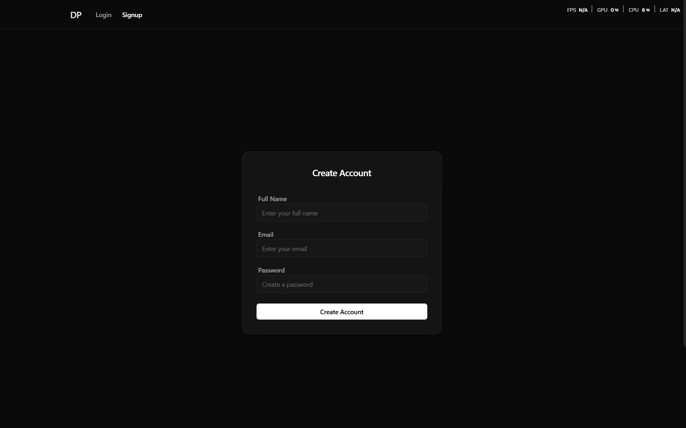

**Login**
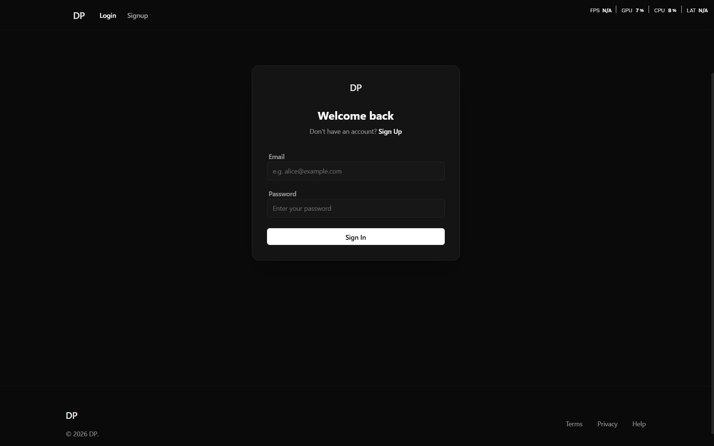

**Profile Selection**
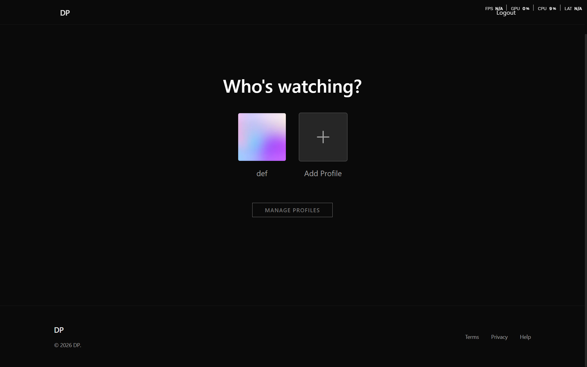

---

### 🧭 Content Discovery

**Movies Home**
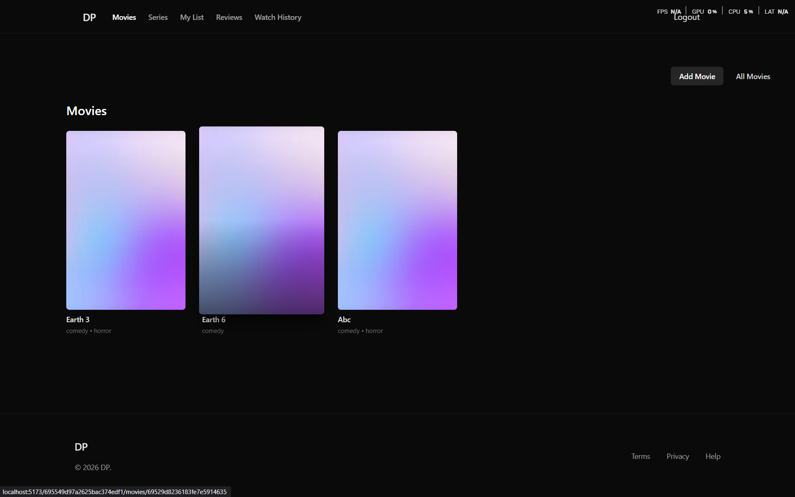

**Series Home**
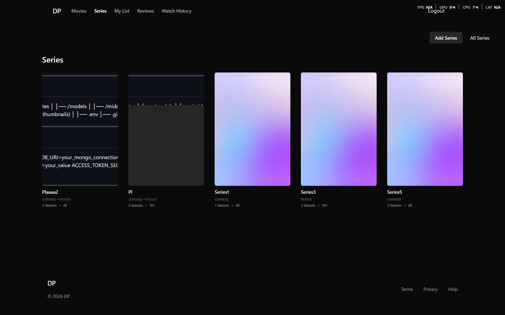

---

### 🎬 Viewing Experience

**Movie Details**
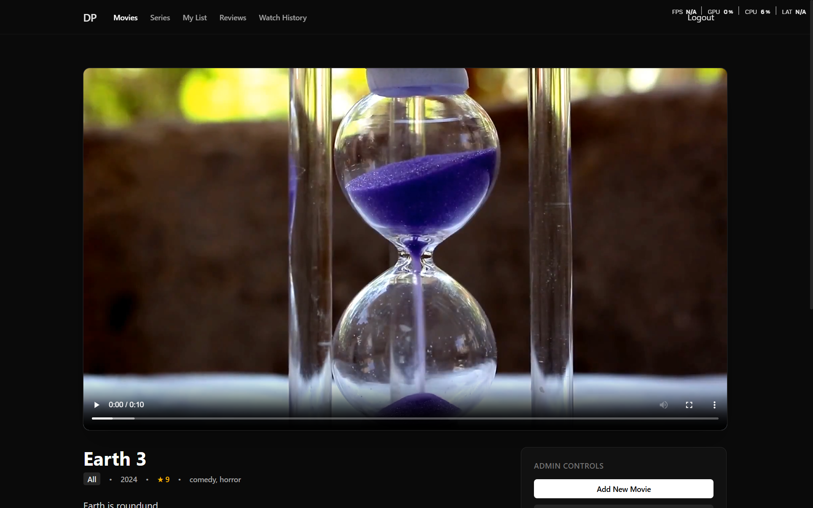

**Episode Player**
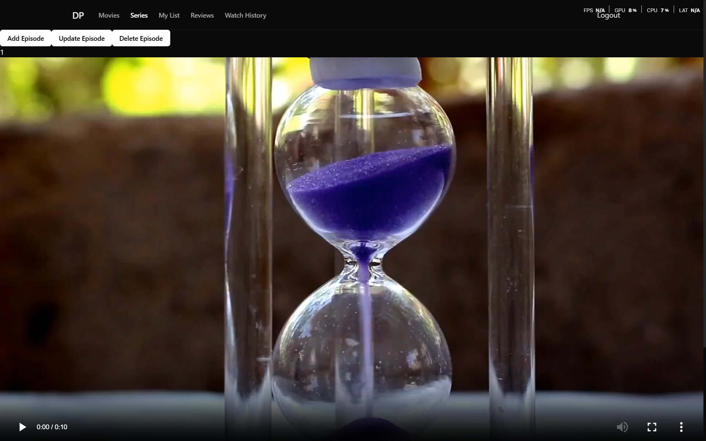

---

### 👤 User Dashboard

**Watch History**
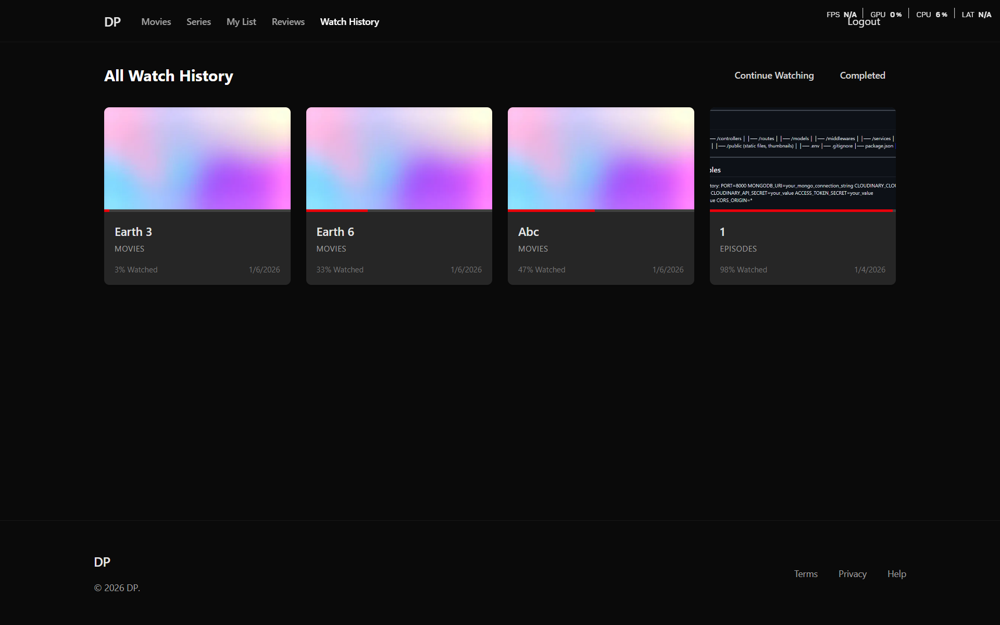

**My Watchlist**
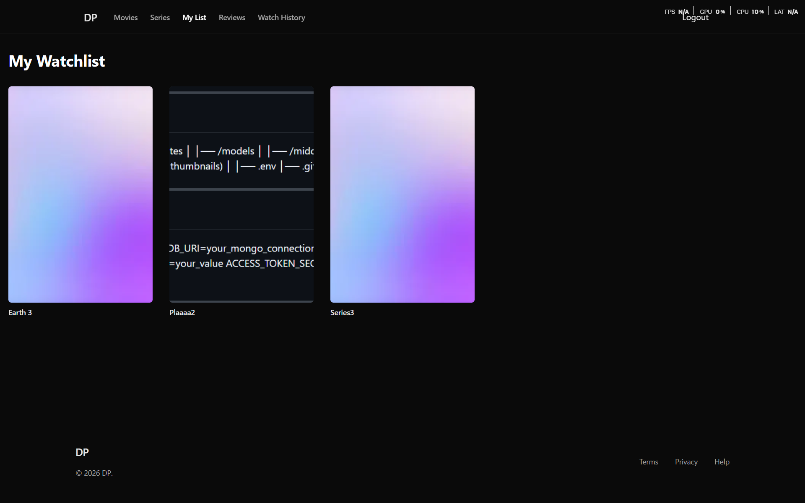

---

### 🛠️ Admin & Management

**Content Management**
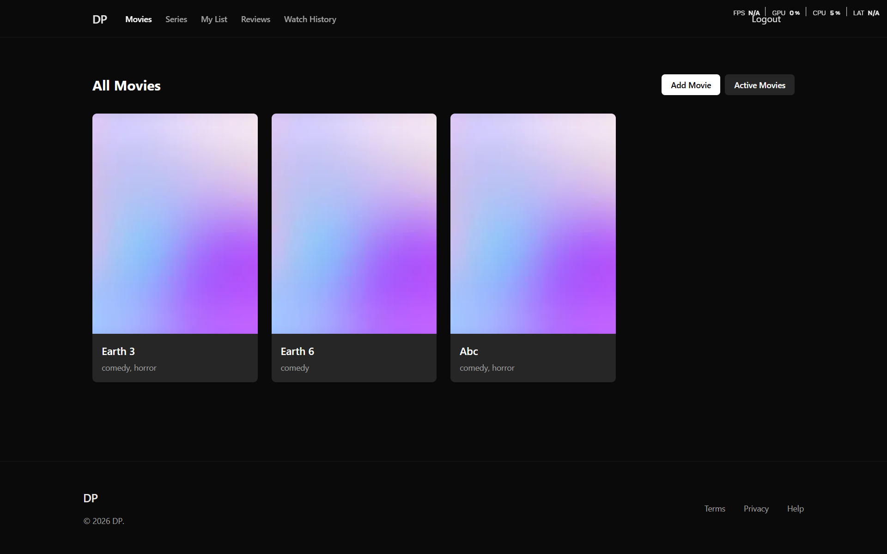

**Review Control**
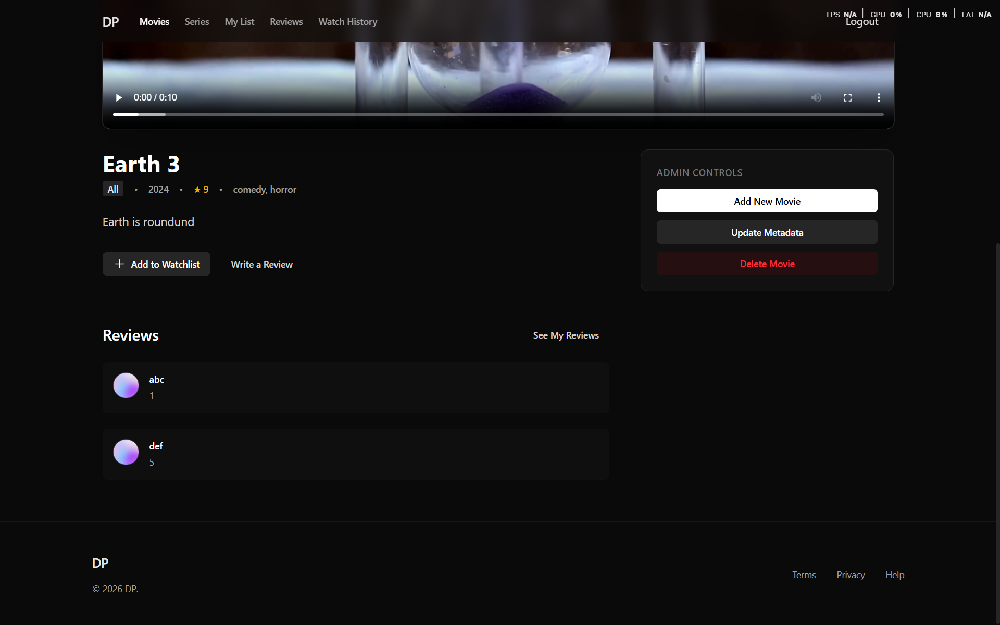

---

## 🏗️ Architecture & Tech Stack

CineFlow is built on a modern **MERN** architecture, designed for fast development and straightforward cloud deployment.

| Layer | Technology | Key Features |
|-------|------------|--------------|
| **Frontend** |    | Redux Toolkit for state, Redux Persist for local storage, Axios for API communication. |
| **Backend** |   | RESTful API design, specialized controllers for Content & User logic. |
| **Database** |  | Mongoose ODM with complex relationship modeling (Series -> Seasons -> Episodes). |
| **Media** |  | Optimized image/video storage and delivery. |

---

## ✨ Core Features

### 👤 User Experience & Identity
*   **Secure Authentication**: robust JWT-based auth flow (Access + Refresh tokens) ensuring secure sessions.
*   **Multi-Profile System**: 
    *   Create up to 5 profiles per account.
    *   **Isolated Data**: Each profile maintains its own Watch History, Watchlist, and Recommendations.
    *   **Avatar Customization**: Users can select unique avatars for their personas.
    *   **Subscription**: Only subscribed allowed to watch

### 📺 Content consumption
*   **Smart Watch History**: 
    *   **Resume Playback**: Automatically tracks progress. Users can resume movies/episodes exactly where they left off.
    *   **Progress Indicators**: Visual bars show completion status on all content cards.
    *   **Categorized History**: "Continue Watching" vs. "Completed" lists.
*   **Personal Watchlist**: "My List" feature for saving content to watch later.
*   **Interactive Reviews**: 
    *   User-generated ratings and comments.
    *   Edit/Delete capabilities for own reviews.
    *   "My Reviews" dashboard to manage feedback history.

### 🛠️ Admin Dashboard
*   **Comprehensive CMS**: Full Create, Read, Update, Delete (CRUD) operations for:
    *   Movies
    *   TV Series
    *   Seasons (linked to Series)
    *   Episodes (linked to Seasons)
*   **Media Management**: Direct upload integrations for thumbnails, banners, and video files.
*   **Content Organization**: Manage genres, age ratings, and release years.

### 🎨 UI/UX Design ("CineFlow" Theme)
*   **Immersive Dark Mode**: A "Content-First" dark aesthetic minimizing distractions.
*   **Mobile Responsive**: Fully optimized grid layouts that adapt from 4K desktops to mobile screens.
*   **Micro-Interactions**: Smooth hover effects, transitions, and loading skeletons for a polished feel.

---

## 🚀 Getting Started (Local Development)

### Prerequisites
*   **Node.js**: v18.0.0 or higher
*   **MongoDB**: Local instance or MongoDB Atlas URI
*   **Cloudinary Account**: For media uploads

### 1. Clone the Repository
```bash
git clone https://github.com/yourusername/OTT.git
cd OTT
```

### 2. Backend Setup
```bash
cd backend
npm install
cp .env.example .env   # On Windows PowerShell: Copy-Item .env.example .env
```
Fill in your credentials in `backend/.env`, then start the development server:
```bash
npm run dev
```
The backend will run on `http://localhost:8000`.

### 3. Frontend Setup
Open a new terminal window:
```bash
cd frontend
npm install
cp .env.example .env   # On Windows PowerShell: Copy-Item .env.example .env
npm run dev
```
The frontend will run on `http://localhost:5173`.

---

## 🌐 Deployment Guide (Render + Vercel)

### Step 1: Deploy Backend (Render)
1. Push your repository to **GitHub**.
2. Go to [render.com](https://render.com) and create a **New Web Service**.
3. Connect your GitHub repository.
4. Configure service settings:
   - **Root Directory**: `backend`
   - **Environment**: `Node`
   - **Build Command**: `npm install`
   - **Start Command**: `npm start`
5. Under **Environment Variables**, add:
   - `PORT`: `8000`
   - `NODE_ENV`: `production`
   - `MONGODB_URI`: your MongoDB Atlas connection string
   - `ACCESS_TOKEN_SECRET`: your secret string
   - `REFRESH_TOKEN_SECRET`: your secret string
   - `CLOUDINARY_CLOUD_NAME`: your Cloudinary cloud name
   - `CLOUDINARY_API_KEY`: your Cloudinary API key
   - `CLOUDINARY_API_SECRET`: your Cloudinary API secret
   - `ADMIN_EMAIL`: your admin email
   - `CORS_ORIGIN`: your Vercel frontend URL (e.g., `https://your-app.vercel.app`)
6. Click **Deploy Web Service** and copy your backend URL (e.g., `https://your-backend.onrender.com`).

### Step 2: Deploy Frontend (Vercel)
1. Go to [vercel.com](https://vercel.com) and click **Add New Project**.
2. Import your GitHub repository.
3. Configure project settings:
   - **Framework Preset**: `Vite`
   - **Root Directory**: `frontend`
   - **Build Command**: `npm run build`
   - **Output Directory**: `dist`
4. Under **Environment Variables**, add:
   - `VITE_SERVER`: `https://your-backend.onrender.com/api/v1`
5. Click **Deploy**.
6. Once deployed, copy your Vercel URL and update `CORS_ORIGIN` in Render to match this URL.

---

## 🔑 Environment Variables

### Backend (`backend/.env`)
| Variable | Description |
|----------|-------------|
| `PORT` | API Port (default: `8000`) |
| `NODE_ENV` | `development` or `production` |
| `MONGODB_URI` | MongoDB Atlas connection string |
| `CORS_ORIGIN` | Frontend origin(s) separated by commas |
| `ACCESS_TOKEN_SECRET` | Secret key for signing JWT access tokens |
| `REFRESH_TOKEN_SECRET` | Secret key for signing JWT refresh tokens |
| `CLOUDINARY_CLOUD_NAME` | Cloudinary account cloud name |
| `CLOUDINARY_API_KEY` | Cloudinary API key |
| `CLOUDINARY_API_SECRET` | Cloudinary API secret |
| `ADMIN_EMAIL` | Email with administrative permissions |

### Frontend (`frontend/.env`)
| Variable | Description |
|----------|-------------|
| `VITE_SERVER` | Full base URL to backend API (e.g., `http://localhost:8000/api/v1` or `https://your-backend.onrender.com/api/v1`) |

<p align="center">
  Built with ❤️ by Rana Darpan
</p>
